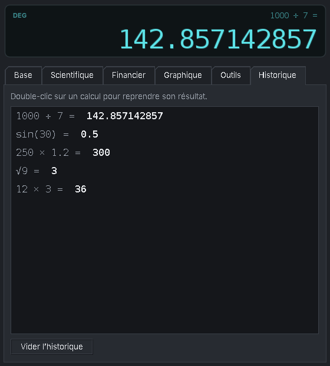

# Kalkul

Calculatrice de bureau en Java Swing, avec un onglet par famille de calculs. Le clavier fonctionne comme les boutons.

<p>
  
  
</p>

L'habillage est fait en Swing seul, sans bibliothèque de thème : thème Metal recoloré en graphite (`Habillage`), touches dessinées et colorées selon leur rôle (`Touche`), écran façon afficheur fluorescent qui rétrécit les nombres trop longs (`Ecran`).

Le thème suit Windows : si les applications sont en mode clair, Kalkul passe en clair (fond gris perle, afficheur façon cristaux liquides). On peut l'imposer au lancement avec `-Dkalkul.theme=clair` ou `-Dkalkul.theme=sombre`.


L'onglet Historique garde les 50 derniers calculs ; un double-clic remet le résultat à l'écran, et le calcul qui vient d'être fait s'affiche en petit au-dessus du nombre.



| Onglet | Contenu |
|---|---|
| Base | Quatre opérations, reste (`mod`), pourcentage, carré, racine carrée, changement de signe, retour arrière |
| Scientifique | sin, cos, tan et leurs réciproques en degrés ou en radians, exp, ln, log, puissance, factorielle |
| Financier | Intérêts simples et composés, mensualité et tableau d'amortissement d'un prêt, VAN, TRI, trésorerie cumulée, conversion monétaire avec un taux saisi |
| Graphique | Courbes à partir d'une formule avec variables (`a*sin(x) + b`), tangente et dérivée en un point, intégrale et aire ; matrices (somme, produit, transposée, déterminant, inverse), systèmes d'équations, produits scalaire et vectoriel ; régression linéaire avec corrélation, seuil de significativité et nuage de points |
| Outils | Moyenne, variance et écart-type ; équation du second degré ; conversion de longueurs, masses, volumes et températures |

Prévu ensuite : enregistrement des formules, taux de change en ligne.

Stack : Java 17, Maven, JUnit 5.

## Lancement

Prérequis : JDK 17 ou plus récent et Maven.

```bash
mvn exec:java
```

Pour produire un JAR exécutable :

```bash
mvn package
java -jar target/kalkul-1.0-SNAPSHOT.jar
```

Sans installer Java : le workflow « Paquets » (lancé à la main ou à chaque tag `v*`) produit un dossier Windows zippé avec Java embarqué (`Kalkul.exe` dedans) et un paquet `.deb` pour Linux, téléchargeables dans les artefacts du passage. Le même résultat en local, après `mvn package` :

```bash
jpackage --type app-image --name Kalkul --input target --main-jar kalkul-1.0-SNAPSHOT.jar --main-class com.kalkul.Kalkul
```

## Tests

```bash
mvn verify
```

## Organisation

| Fichier | Rôle |
|---|---|
| `MoteurCalcul.java` | Logique de l'écran : reçoit les touches et renvoie le texte à afficher |
| `FonctionsScientifiques.java` | Trigonométrie, logarithmes, factorielle, second degré, statistiques |
| `Conversions.java` | Conversion d'unités |
| `FormulesFinancieres.java` | Intérêts, prêt, amortissement, VAN, TRI, trésorerie |
| `PanneauFinance.java` | Formulaires de l'onglet Financier |
| `Expression.java` | Lecture et calcul d'une formule avec variables, constantes et fonctions |
| `Analyse.java` | Dérivée (différence centrée) et intégrale (Simpson) |
| `Matrice.java`, `Vecteurs.java`, `CalculMatriciel.java` | Algèbre linéaire et opérations de l'onglet Matrices |
| `Regression.java`, `StudentT.java` | Droite des moindres carrés, corrélation et p-value de la pente |
| `EchantillonCourbe.java`, `TraceCourbe.java` | Points d'une courbe et dessin Java2D |
| `PanneauGraphique.java`, `PanneauCourbe.java`, `PanneauMatrices.java`, `PanneauRegression.java` | Écrans de l'onglet Graphique |
| `Kalkul.java` | Fenêtre, onglets et clavier ; transmet chaque touche au moteur |
| `PanneauTouches.java` | Grille de boutons réutilisée par les onglets Base et Scientifique |
| `PanneauOutils.java` | Formulaires de l'onglet Outils |
| `src/test/java/...` | Tests du moteur, des fonctions et des conversions |

Les opérations s'enchaînent de gauche à droite, sans priorité : `2 + 3 * 4` donne 20. L'écran garde 12 chiffres significatifs, donc `0,1 + 0,2` affiche 0,3. La variance est celle d'une population (division par n). Dans les formules, les angles sont en radians, la puissance se lit de droite à gauche (`2^3^2` donne 512) et le séparateur décimal est le point. La significativité est le test bilatéral de Student sur la pente : sous 0,05, la pente est dite significative.

## Licence

MIT, voir [LICENSE](LICENSE).
