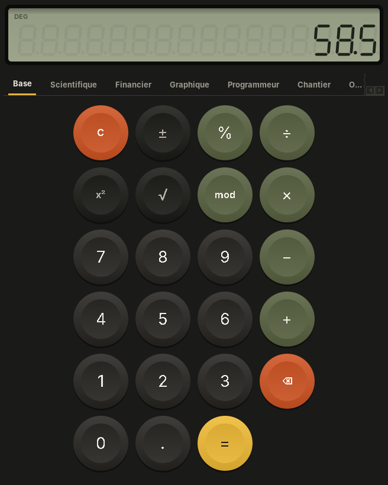
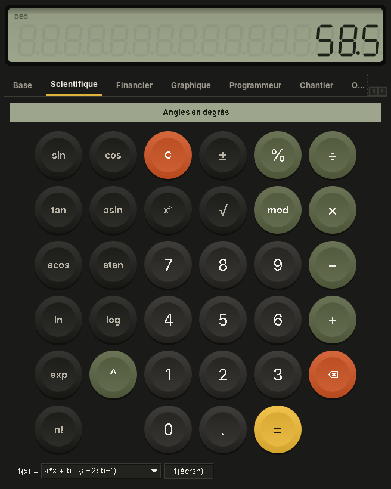
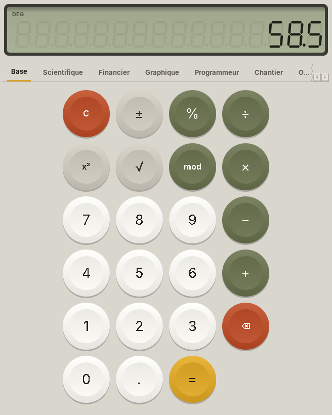
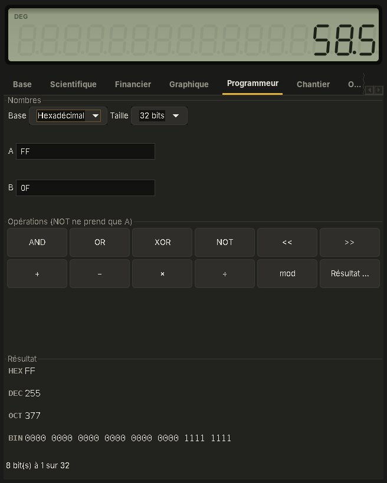
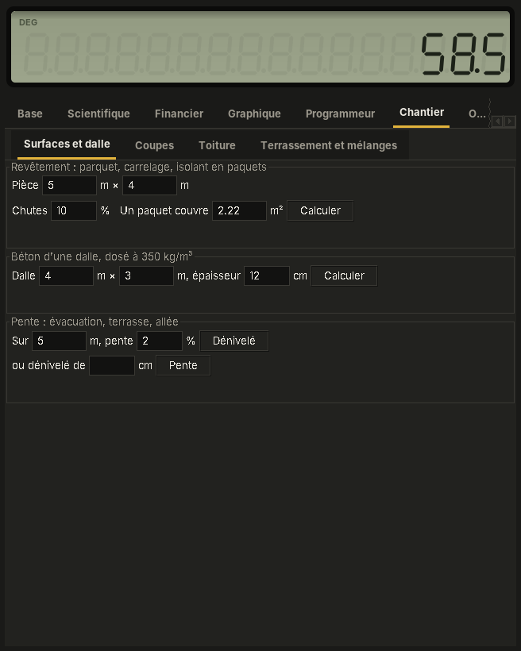
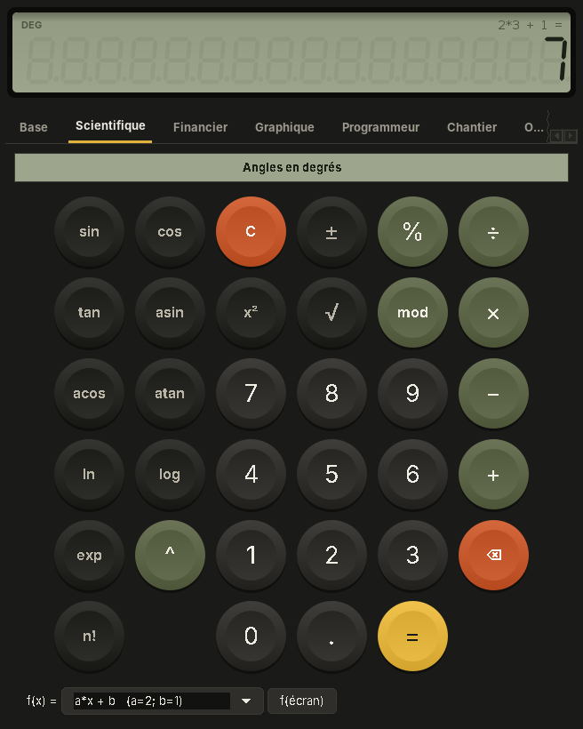

# Kalkul

Calculatrice de bureau en Java Swing, avec un onglet par famille de calculs. Le clavier fonctionne comme les boutons.

<p>
  
  
</p>

L'habillage est fait en Swing seul, sans bibliothèque de thème : thème Metal recoloré en graphite (`Habillage`), touches dessinées et colorées selon leur rôle (`Touche`), écran façon afficheur fluorescent qui rétrécit les nombres trop longs (`Ecran`).

Le thème suit Windows : si les applications sont en mode clair, Kalkul passe en clair (fond gris perle, afficheur façon cristaux liquides). On peut l'imposer au lancement avec `-Dkalkul.theme=clair` ou `-Dkalkul.theme=sombre`.



L'onglet Historique garde les 50 derniers calculs ; un double-clic remet le résultat à l'écran, et le calcul qui vient d'être fait s'affiche en petit au-dessus du nombre.


L'onglet Programmeur travaille sur des entiers de 8 à 64 bits : saisie en hexadécimal, décimal, octal ou binaire, résultat dans les quatre bases, AND, OR, XOR, NOT, décalages et les quatre opérations, négatifs en complément à deux.



L'onglet Chantier compte les paquets de revêtement avec la marge de chute, le béton d'une dalle (ciment en sacs, sable, gravillons, eau) et la pente d'une évacuation. Les conversions de l'onglet Outils gagnent les surfaces, les m³, la tonne, la brouette et la pente en %, mm/m, cm/m ou degrés. Trois sous-onglets complètent le premier :

- Coupes : onglet d'une plinthe selon l'angle du mur, coupe composée d'une pièce inclinée (corniche, pièce de trémie) en angle de table et inclinaison de lame, chevron contre un arêtier (aplomb, pied, joue, et réglage de la scie chevron couché sur sa joue).
- Toiture : pente en %, en degrés et en cm par mètre, depuis l'une des trois ou depuis la montée, longueur du rampant, et comparaison avec une pente minimale indicative par couverture (tuile canal, à emboîtement, plate, ardoise). Ces minimums dépendent du modèle, de la région et du rampant : la notice du fabricant fait foi.
- Terrassement et mélanges : volume d'une fouille avec le foisonnement et les big bags à évacuer, sable, gravier ou tout-venant d'un remblai en tonnes et en big bags, gâchée de béton, de mortier ou d'enduit selon le dosage (sacs de ciment, seaux de sable et de gravier, eau, et la même chose pour un sac). Densités et proportions sont indicatives.



Une formule de l'onglet Graphique s'enregistre avec ses paramètres (20 au plus, gardées d'une session à l'autre dans les préférences Java de l'utilisateur). Elle se retrouve dans l'onglet Scientifique, où « f(écran) » l'applique au nombre affiché : le calcul s'écrit avec ses nombres (`2*3 + 1`) et part dans l'historique.



L'onglet Feuille garde jusqu'à 12 cellules nommées (`surface = 4.2*3.5`, `prix = surface*24.9`), d'une session à l'autre. Une cellule peut reprendre les autres ; une référence circulaire ou une valeur manquante est refusée. Les noms ne prennent que des lettres sans accent, et pas `x`, `pi`, `e` ni un nom de fonction. Les cellules servent de variables aux formules enregistrées, dans l'onglet Feuille, dans « f(écran) » et dans les courbes ; un paramètre de la formule passe avant une cellule du même nom.

L'onglet Outils réunit aussi la règle de trois et les pourcentages : pourcentage d'une valeur, part en %, variation, prix après une ou deux remises successives (20 % puis 10 % font 28 %), prix avant remise et prix au mètre carré.

| Onglet | Contenu |
|---|---|
| Base | Quatre opérations, reste (`mod`), pourcentage, carré, racine carrée, changement de signe, retour arrière |
| Scientifique | sin, cos, tan et leurs réciproques en degrés ou en radians, exp, ln, log, puissance, factorielle |
| Financier | Intérêts simples et composés, mensualité et tableau d'amortissement d'un prêt, VAN, TRI, trésorerie cumulée, conversion monétaire avec un taux saisi |
| Graphique | Courbes à partir d'une formule avec variables (`a*sin(x) + b`), tangente et dérivée en un point, intégrale et aire ; matrices (somme, produit, transposée, déterminant, inverse), systèmes d'équations, produits scalaire et vectoriel ; régression linéaire avec corrélation, seuil de significativité et nuage de points |
| Chantier | Revêtement, dalle et pente ; angles de coupe ; toiture ; terrassement et gâchées |
| Outils | Moyenne, variance et écart-type ; équation du second degré ; conversion de longueurs, masses, volumes et températures ; règle de trois, pourcentages et remises |
| Feuille | Cellules nommées, réutilisées par les formules enregistrées |

Prévu ensuite : taux de change en ligne.

Stack : Java 17, Maven, JUnit 5.

## Lancement

Prérequis : JDK 17 ou plus récent et Maven.

```bash
mvn exec:java
```

Pour produire un JAR exécutable :

```bash
mvn package
java -jar target/kalkul-1.0-SNAPSHOT.jar
```

Sans installer Java : le workflow « Paquets » (lancé à la main ou à chaque tag `v*`) produit un dossier Windows zippé avec Java embarqué (`Kalkul.exe` dedans) et un paquet `.deb` pour Linux, téléchargeables dans les artefacts du passage. Le même résultat en local, après `mvn package` :

```bash
jpackage --type app-image --name Kalkul --input target --main-jar kalkul-1.0-SNAPSHOT.jar --main-class com.kalkul.Kalkul
```

## Tests

```bash
mvn verify
```

## Organisation

| Fichier | Rôle |
|---|---|
| `MoteurCalcul.java` | Logique de l'écran : reçoit les touches et renvoie le texte à afficher |
| `FonctionsScientifiques.java` | Trigonométrie, logarithmes, factorielle, second degré, statistiques |
| `Conversions.java` | Conversion d'unités |
| `FormulesFinancieres.java` | Intérêts, prêt, amortissement, VAN, TRI, trésorerie |
| `PanneauFinance.java` | Formulaires de l'onglet Financier |
| `Expression.java` | Lecture et calcul d'une formule avec variables, constantes et fonctions |
| `Analyse.java` | Dérivée (différence centrée) et intégrale (Simpson) |
| `Matrice.java`, `Vecteurs.java`, `CalculMatriciel.java` | Algèbre linéaire et opérations de l'onglet Matrices |
| `Regression.java`, `StudentT.java` | Droite des moindres carrés, corrélation et p-value de la pente |
| `EchantillonCourbe.java`, `TraceCourbe.java` | Points d'une courbe et dessin Java2D |
| `PanneauGraphique.java`, `PanneauCourbe.java`, `PanneauMatrices.java`, `PanneauRegression.java` | Écrans de l'onglet Graphique |
| `Kalkul.java` | Fenêtre, onglets et clavier ; transmet chaque touche au moteur |
| `PanneauTouches.java` | Grille de boutons réutilisée par les onglets Base et Scientifique |
| `PanneauOutils.java`, `PanneauProportions.java` | Formulaires de l'onglet Outils |
| `Proportions.java` | Règle de trois, pourcentages, remises, prix au m² |
| `FeuilleCalcul.java`, `PanneauFeuille.java` | Cellules nommées et onglet Feuille |
| `Chantier.java`, `Coupes.java`, `Toiture.java`, `Terrassement.java`, `Melanges.java` | Calculs de l'onglet Chantier : revêtement, dalle, pente, angles de coupe, toiture, terrassement, gâchées |
| `PanneauChantier.java`, `PanneauCoupes.java`, `PanneauToiture.java`, `PanneauTerrassement.java` | Écrans de l'onglet Chantier |
| `src/test/java/...` | Tests du moteur, des fonctions et des conversions |

Les opérations s'enchaînent de gauche à droite, sans priorité : `2 + 3 * 4` donne 20. L'écran garde 12 chiffres significatifs, donc `0,1 + 0,2` affiche 0,3. La variance est celle d'une population (division par n). Dans les formules, les angles sont en radians, la puissance se lit de droite à gauche (`2^3^2` donne 512) et le séparateur décimal est le point. La significativité est le test bilatéral de Student sur la pente : sous 0,05, la pente est dite significative.

## Licence

MIT, voir [LICENSE](LICENSE).
